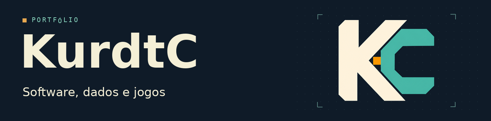

Gosto de projetos que começam com uma pergunta pequena. Uma que veio dos jogos foi **“depois de três semanas sem jogar, como lembro o que eu ia fazer?”**. A resposta muda o que vale a pena guardar em um diário de campanha.

## Um estudo em SQL · Diário de campanha

Este exemplo usa duas campanhas fictícias. A consulta mostra a última sessão de cada jogo, soma o tempo jogado e recupera a anotação que ajuda a retomar de onde se parou. Uma missão abandonada e uma pista ainda sem resposta dizem mais sobre a próxima sessão do que um percentual de conclusão.

[Abrir o exemplo em SQL](./diario-de-campanha.sql)

## Interesses

- **Software e projetos pessoais** — protótipos pequenos o bastante para testar uma ideia de ponta a ponta.
- **Python e dados** — organização de registros, consultas e resultados que dá para conferir com um exemplo.
- **Jogos** — diários de campanha, escolhas de narrativa e o que uma biblioteca poderia contar sobre a experiência de jogar.

English overview

I explore software and data through personal projects. The SQL example above asks a simple question: when you return to a game after a few weeks, what would help you pick up where you left off? It combines session history with a short note about what to do next.

